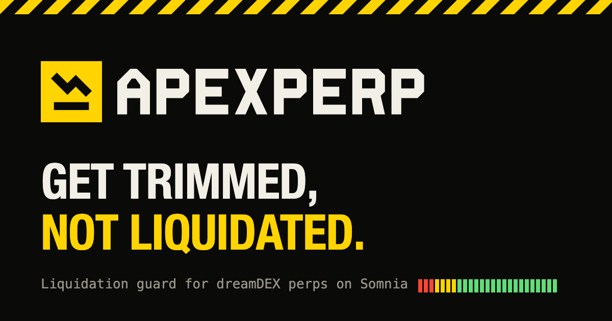

<p align="center">
  <picture>
    <source media="(prefers-color-scheme: dark)" srcset="public/brand/logo-dark.svg">
    
  </picture>
</p>

<p align="center"><b>Get trimmed, not liquidated.</b><br>A liquidation guard for dreamDEX perps on Somnia.</p>

<p align="center">
  <a href="LIVE_APP_URL">Live app</a> ·
  <a href="DEMO_VIDEO_URL">Demo video</a> ·
  <a href="PROOF.md">On-chain proof</a> ·
  <a href="feedback/">SDK feedback</a>
</p>



## What it does

Perps traders lose whole positions to liquidation because a wick hits while they're asleep, busy, or just not watching. ApexPerp fixes that in three layers:

1. **See how close you are.** Connect a wallet (or paste any address) and get your real account health from the dreamDEX MarginBank: equity over the maintenance margin you must keep. For every position you see the exact mark price where it would get trimmed, closed, or liquidated.
2. **Protect it on-chain, in one click.** ApexPerp places two reduce-only stop orders per position on dreamDEX's `PerpStopOrderRegistry`: one that sells 25% at the trim price, one that closes everything at the close price. **Somnia Reactivity** fires them when the mark crosses the line. No bot, no server, no key handed over, and they keep working with your laptop shut.
3. **Or run the Sentinel.** An always-on agent that watches whole-account health every second and sends reduce-only market orders below your thresholds, for traders who want account-level logic on top of per-position stops.

Everything it sends can only shrink a position. It never opens or flips one.

## Who it's for

- **dreamDEX traders** running leverage who don't want one wick to wipe out their margin.
- **Perps Arena players**, where getting liquidated knocks you off the board.
- **Bot builders**, who get a tested, reusable reduce-only and stop-order layer (`agent/`).

## Proof it works

Every transaction ApexPerp sends is logged with its hash, block and status in [PROOF.md](PROOF.md). Hideki has no public explorer, so check any hash with `eth_getTransactionReceipt` against `https://api.hideki2.infra.testnet.somnia.network`.

## Run it

Requires Node 20+.

```bash
git clone https://github.com/southenempire/apexperp-ai.git
cd apexperp-ai
npm install
npm run dev            # the dapp on http://localhost:3000
```

Command line, with a funded Somnia Tokyo testnet wallet (join the Perps Arena on [dreamDEX](https://app.testnet.dreamdex.io) for paper USDso):

```bash
cp .env.example .env              # set PRIVATE_KEY
npm run doctor                    # checks RPC, indexer, mark prices and your wallet
npm run open -- ETH long 0.01     # open a test position
npm run protect                   # arm on-chain trim + close stops for every position
npm run protect -- --list         # see your stops (--cancel removes them, fees refunded)
npm run agent:live                # run the Sentinel (DRY_RUN=1 to log without sending)
```

| Setting | Default | Meaning |
| :--- | :--- | :--- |
| `REDUCE_BELOW_HEALTH` | `1.5` | Trim when equity / maintenance margin falls to this |
| `FLATTEN_BELOW_HEALTH` | `1.15` | Close everything at this |
| `REDUCE_PERCENTAGE` | `25` | How much one trim sells |
| `MAX_SLIPPAGE` | `0.02` | Worst fill for a Sentinel market order |

## How it's built

```
src/                     React dapp (Vite + Tailwind)
  pages/Landing.tsx      landing page with the drag-the-price breaker demo
  pages/Dashboard.tsx    health, positions, on-chain stops, trades, markets
  lib/wallet.tsx         injected wallet, switches/adds Somnia Tokyo, binds the SDK signer
  lib/hooks.ts           live reads from the chain and indexer
agent/                   shared trading logic (used by the dapp and the CLI)
  protection.ts          trigger-price solve, stop planning, arm / list / cancel stops
  sentinel.ts            health ratio, decisions, reduce-only sizing (pure, unit-tested)
  markets.ts             connection, market discovery, reduce-only order planning
  runner.ts              the always-on Sentinel
scripts/                 doctor, open-position, protect, tests, brand assets
feedback/                SDK and docs reports for the feedback track, with a repro script
```

- **Trigger prices** solve `equity(p) = k × maintenance(p)` for each market by scaling the SDK's own `perpLiquidationPrice`, so they match the protocol's liquidation math exactly (k = 1 is liquidation).
- **Stops** are placed with `trader.placePerpStopOrder` as reduce-only MARKET stops. The trim leg has a fixed size; the close leg uses quantity `0`, which the registry resolves to the whole position when it fires.
- **Somnia primitives:** perp stops are triggered through Somnia Reactivity (prepaid per stop, refunded on cancel). Tokyo's 10 ms blocks make the Sentinel's one-second loop practical.

Tests: `npm run test:sentinel` covers the health maths, decisions, reduce-only sizing, trigger-price solving, stop planning for longs and shorts, and telling stop-losses from take-profits.

## Feedback track

Five reproducible reports in [`feedback/`](feedback/), one per file in the bounty template. Reproduce all of them, read-only, with:

```bash
npm run feedback:repro
```

| # | Severity | Issue |
| :--- | :--- | :--- |
| 01 | major | Perp stop orders fail on Tokyo: the Hideki address preset has no `operatorPermissionsRegistry` |
| 02 | normal | `docs/PERPS.md` lists perp symbols the SDK rejects, and says only BTC and ETH are live |
| 03 | normal | "unknown symbol" error says to call `loadMarkets()` after it already ran |
| 04 | normal | README testnet setup connects to Shannon, not Tokyo where the perps are |
| 05 | normal | No reduce-only option for perp orders and no SDK read for reducing capacity |

## X posts

- POST_1_URL
- POST_2_URL
- POST_3_URL

## Network

| | |
| :--- | :--- |
| Network | Somnia Tokyo testnet (Hideki) |
| Chain ID | `50383` |
| RPC | `https://api.hideki2.infra.testnet.somnia.network` |
| Indexer | `https://hideki-dev.smk.somnia.host/v1/graphql` |
| MarginBank | `0x478769E1177C0773c43A593DCCc4Ad15F15F1394` |
| Operator permissions registry | `0x6B2FbfeD328FF5F20C0BE7D3C3437613aFFE8D3a` |

Built for the [dreamDEX Perps Builder Bounty](https://dorahacks.io/hackathon/dreamdex-perps-bounty/detail).
